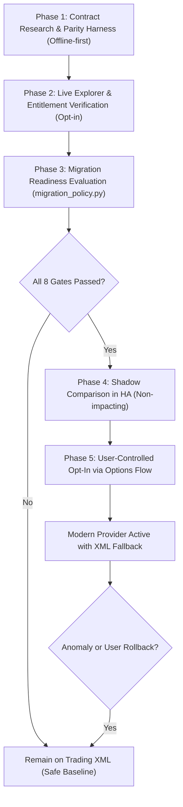

# Existing-User API Migration Architecture & Rollback Strategy

This document outlines the architectural plan for eventually migrating existing Home Assistant users from legacy eBay Trading XML APIs (`GetMyeBayBuying`, `GetMyeBaySelling`) to modern eBay GraphQL and REST APIs without disrupting established configurations, entity IDs, automations, or dashboards.

---

## 1. Architectural Invariants

To safeguard existing Home Assistant installations, every modern API migration must adhere to five non-negotiable invariants:

1. **Config-Entry Identity Preservation**:
   - The integration's `ConfigEntry` instance and its `entry_id` remain permanent.
   - Config-entry version is **not** incremented unnecessarily for scaffolding.
   - User credentials (`client_id`, `client_secret`, `runame`, `refresh_token`), environment (`production` vs. `sandbox`), marketplace `site_id`, and existing OAuth tokens are preserved without requiring re-authentication or re-adding the integration.

2. **Entity ID & Unique ID Stability**:
   - Fixed entity unique IDs (`{entry_id}_watching`, `{entry_id}_bidding`, `{entry_id}_active_listings`, `{entry_id}_sold_items`, `{entry_id}_unsold_items`, etc.) remain identical regardless of the underlying API source.
   - Per-item entity unique IDs (`{entry_id}_{kind}_{item_id}_price`) remain identical regardless of whether item data originates from XML or modern APIs.
   - Dashboards, history graphs, long-term statistics, and entity registries continue uninterrupted.

3. **Automation Event Contract Continuity**:
   - Fired event types (`ebay_watched_item_ending_soon`, `ebay_price_drop`, `ebay_outbid`, `ebay_seller_at_risk`, `ebay_buyer_question`, `ebay_order_overdue`) retain identical payload contracts (`entry_id`, `item_id`, `title`, prices, timestamps).
   - Event deduplication state (`ending_soon_store` and `inactive_item_store`) remains fully compatible across providers.

4. **Production Default to Trading XML**:
   - Every feature defaults strictly to `TRADING_XML` in production runtime.
   - A modern API provider is never activated in production until its readiness has been conclusively established and verified.

5. **Instant Fallback and Rollback**:
   - If a modern API provider encounters errors, rate limits, or unexpected schema changes, execution safely falls back to Trading XML.
   - Users retain the ability to roll back any migrated feature to Trading XML with immediate effect.

---

## 2. Migration Readiness Gates

A candidate modern provider (GraphQL or REST) must satisfy **all eight readiness gates** in [`custom_components/ebay/migration_policy.py`](../custom_components/ebay/migration_policy.py) before it can be considered for active production migration:

| Gate | Requirement | Failure Consequence |
|---|---|---|
| **1. Fallback Available** | Trading XML provider is functional and configured as fallback | `BLOCKED_NO_FALLBACK`: Migration rejected |
| **2. Account Identity** | Modern API response matches authenticated account identity | `BLOCKED_IDENTITY`: Migration rejected |
| **3. Verified Scopes** | All required OAuth scopes are present in the granted token | `BLOCKED_SCOPE`: Migration rejected |
| **4. Entitlement & Auth** | Live resolver/endpoint returns HTTP 200 without `FORBIDDEN` | `BLOCKED_AUTHORIZATION`: Migration rejected |
| **5. Schema Validation** | Query document and response types pass schema validation | `BLOCKED_SCHEMA`: Migration rejected |
| **6. Complete Census** | Response represents 100% of the active collection | `BLOCKED_COMPLETENESS`: Migration rejected |
| **7. Verified Pagination** | Bounded pagination, cursor continuation, and totals verified | `BLOCKED_PAGINATION`: Migration rejected |
| **8. Field-Level Parity** | All monitored fields match Trading XML semantics | `BLOCKED_PARITY`: Migration rejected |

> [!IMPORTANT]
> A speculative GraphQL query, synthetic offline fixture, or partial SKU inventory response **never** satisfies readiness. A `FORBIDDEN` error (such as observed on `userWatchList`) or unverified pagination strictly blocks migration readiness.

---

## 3. Phased Rollout & Migration Lifecycle

### Phase 1: Research, Normalization & Parity Validation (Completed for M1, M4, M5)
- Define modern queries, data models, and fail-closed normalization parsers.
- Build private, opt-in CLI parity test tools (`scripts/validate_*_parity.py`).
- Implement exhaustive offline test suites covering partial errors, duplicate IDs, and contradictory pagination.

### Phase 2: Live Entitlement Verification
- Confirm exact required OAuth scopes and developer entitlements via eBay GraphQL Explorer.
- Distinguish between sandbox availability and live production entitlement.
- Verify live resolver permissions without modifying production runtime polling.

### Phase 3: Readiness Assessment
- `MigrationPolicy.evaluate_readiness()` checks the 8 readiness gates against observed evidence.
- Exposes nonsecret, sanitized diagnostics (`FeatureReadiness.to_options_dict()`).

### Phase 4: Shadow Parity Validation (Future)
- Once readiness is established, Home Assistant can optionally poll modern APIs in parallel with Trading XML in a non-impacting "shadow" mode.
- Validates real-world parity, rate limits, and latency under actual network conditions without altering sensor states or firing events.

### Phase 5: User-Controlled Migration & Rollback
- Expose feature provider options in Home Assistant's **Configure (Options Flow)** interface.
- Provide clear readiness indicators for each feature domain.
- Allow users to selectively switch feature providers with instant, one-click rollback to Trading XML.
