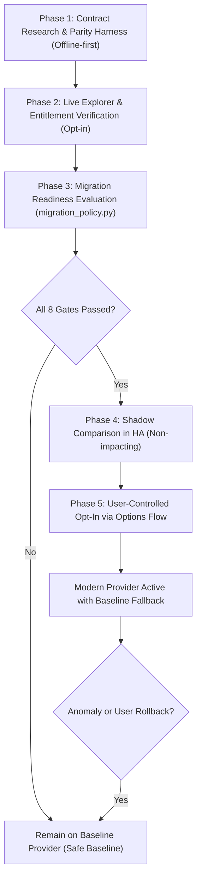

# Existing-User API Migration Architecture & Rollback Strategy

This document outlines the architectural plan for eventually migrating existing Home Assistant users from legacy eBay Trading XML APIs (`GetMyeBayBuying`, `GetMyeBaySelling`) to modern eBay GraphQL and REST APIs without disrupting established configurations, entity IDs, automations, or dashboards.

---

## 1. Ground Truth Production Provider Baselines

The integration does **not** treat all feature domains as legacy Trading XML. Different domains already use different authoritative API providers in production:

| Feature Domain | Production Baseline Provider | Authoritative API Endpoint | Modern Migration Needed? |
|---|---|---|---|
| **Watchlist** (`FeatureKey.WATCHLIST`) | `TRADING_XML` | `GetMyeBayBuying` (`WatchList`) | Yes (Candidate: GraphQL `userWatchList`) |
| **Bidding** (`FeatureKey.BIDDING`) | `TRADING_XML` | `GetMyeBayBuying` (`BidList`) | Yes (Candidate: GraphQL `userBiddingActivity`) |
| **Seller Listings** (`FeatureKey.SELLER_LISTINGS`) | `TRADING_XML` | `GetMyeBaySelling` (`ActiveList`) | Yes (Candidate: GraphQL `activeSellerListings`) |
| **Offers** (`FeatureKey.OFFERS`) | `TRADING_XML` | `GetMyeBaySelling` (Best offer fields) | Yes (Candidate: REST / GraphQL) |
| **Sold / Unsold** (`FeatureKey.SOLD_UNSOLD`) | `TRADING_XML` | `GetMyeBaySelling` (`SoldList`, `UnsoldList`) | Yes (Candidate: REST / GraphQL) |
| **Fulfillment Orders** (`FeatureKey.ORDERS`) | `REST` | `/sell/fulfillment/v1/order` & dispute APIs | **No** (Already modern REST; XML is not a fallback) |
| **Seller Standards** (`FeatureKey.SELLER_STANDARDS`) | `REST` | `/sell/analytics/v1/seller_standards_profile` | **No** (Already modern REST; XML is not a fallback) |
| **Messages** (`FeatureKey.MESSAGES`) | `REST` | Commerce Message REST client | **No** (Already modern REST; XML is not a fallback) |
| **Analytics** (`FeatureKey.ANALYTICS`) | `REST` | `/sell/analytics/v1/traffic_report` | **No** (Already modern REST; XML is not a fallback) |
| **Finances** (`FeatureKey.FINANCES`) | `REST` | `/sell/finances/v1/transaction` & payouts | **No** (Already modern REST; XML is not a fallback) |
| **Account Privileges** (`FeatureKey.ACCOUNT_PRIVILEGES`) | `REST` | `/sell/account/v1/privilege` | **No** (Already modern REST; XML is not a fallback) |
| **Feedback** (`FeatureKey.FEEDBACK`) | `HYBRID` | Trading XML `GetUser` (username) + REST Feedback API | Future (Candidate: REST username lookup) |

> [!IMPORTANT]
> Trading XML is **never** a fallback for REST-native features (such as Orders or Seller Standards), nor is an XML-to-modern migration required for domains already operating on modern eBay REST endpoints.

---

## 2. Architectural Invariants

To safeguard existing Home Assistant installations, every modern API migration must adhere to five non-negotiable invariants:

1. **Config-Entry Identity Preservation**:
   - The integration's `ConfigEntry` instance and its `entry_id` remain permanent.
   - Config-entry version is **not** incremented unnecessarily for scaffolding.
   - User credentials (`client_id`, `client_secret`, `runame`, `refresh_token`), environment (`production` vs. `sandbox`), marketplace `site_id`, and existing OAuth tokens are preserved without requiring re-authentication or re-adding the integration.

2. **Entity ID & Unique ID Stability**:
   - Fixed summary sensor unique IDs (`{entry_id}_{key}`) match the actual description keys in `sensor.py`:
     - Watchlist: `{entry_id}_watched_items`, `{entry_id}_watched_ending_soon`
     - Bidding: `{entry_id}_bidding_items`
     - Seller listings: `{entry_id}_active_selling_items`, `{entry_id}_sold_items_count`, `{entry_id}_unsold_items_count`, `{entry_id}_selling_total_bids`, `{entry_id}_selling_total_offers`, `{entry_id}_active_listings_quantity_sold`, `{entry_id}_selling_total_watchers`, `{entry_id}_selling_total_views`, `{entry_id}_selling_ending_soon`
     - Orders: `{entry_id}_orders_overdue`, `{entry_id}_open_payment_disputes`
     - Feedback: `{entry_id}_feedback_score`, `{entry_id}_positive_feedback_percent`
     - Seller Standards: `{entry_id}_seller_level`
     - Messages: `{entry_id}_unread_conversations`
   - Per-item entity unique IDs (`{entry_id}_{kind}_{item_id}_{suffix}`) strictly preserve the production kinds (`watched`, `bidding`, `selling`) and field suffixes from `ITEM_SENSOR_FIELDS` in `sensor.py`.
   - Dashboards, history graphs, long-term statistics, and entity registries continue uninterrupted.

3. **Automation Event Contract Continuity**:
   - Fired event types match the true EventEntity constants in `const.py`:
     - `WATCHING_EVENT_TYPES`: `watched_item_ending_soon`, `watched_item_price_changed`, `watched_item_price_decreased`, `watched_item_price_dropped_below`, etc.
     - `BIDDING_EVENT_TYPES`: `outbid`, `winning`, `bidding_item_ending_soon`, etc.
     - `SELLING_EVENT_TYPES`: `selling_item_added`, `bid_count_increased`, `offer_received`, `question_received`, `item_sold`, `item_ended_unsold`, etc.
     - `SELLER_OPS_EVENT_TYPES`: `shipment_overdue`, `payment_dispute_opened`, `seller_level_changed`, `seller_standard_at_risk`, `new_buyer_question`, etc.
   - Event deduplication state (`ending_soon_store` and `inactive_item_store`) remains fully compatible across providers.

4. **Production Baseline & Options Flow Gating**:
   - Every feature defaults strictly to its established baseline provider in production runtime.
   - `MigrationPolicy.get_active_provider()` fails closed: candidate providers are never activated without explicit user opt-in (`enable_modern_api_migration`), supported provider matching, and proven readiness.

5. **Instant Fallback and Rollback**:
   - For legacy baseline features, if a candidate modern API provider encounters errors, rate limits, or unexpected schema changes, execution safely falls back to Trading XML.
   - Users retain the ability to roll back any migrated feature to the baseline provider with immediate effect.

---

## 3. Migration Readiness Gates

A candidate modern provider (GraphQL or REST) must satisfy **all eight readiness gates** in [`custom_components/ebay/migration_policy.py`](../custom_components/ebay/migration_policy.py) before it can be considered for active production migration:

| Gate | Requirement | Failure Consequence |
|---|---|---|
| **1. Fallback Available** | Baseline provider is functional and configured as fallback | `BLOCKED_NO_FALLBACK`: Migration rejected |
| **2. Account Identity** | Modern API response matches authenticated account identity | `BLOCKED_IDENTITY`: Migration rejected |
| **3. Verified Scopes** | All required OAuth scopes are present in the granted token | `BLOCKED_SCOPE`: Migration rejected |
| **4. Entitlement & Auth** | Live resolver/endpoint returns HTTP 200 without `FORBIDDEN` | `BLOCKED_AUTHORIZATION`: Migration rejected |
| **5. Schema Validation** | Query document and response types pass schema validation | `BLOCKED_SCHEMA`: Migration rejected |
| **6. Complete Census** | Response represents 100% of the active collection | `BLOCKED_COMPLETENESS`: Migration rejected |
| **7. Verified Pagination** | Bounded pagination, cursor continuation, and totals verified | `BLOCKED_PAGINATION`: Migration rejected |
| **8. Field-Level Parity** | All monitored fields match baseline semantics | `BLOCKED_PARITY`: Migration rejected |

> [!IMPORTANT]
> A speculative GraphQL query, synthetic offline fixture, or partial SKU inventory response **never** satisfies readiness. A `FORBIDDEN` error (such as observed on `userWatchList`) or unverified pagination strictly blocks migration readiness.

---

## 4. Contract Verification Methodology

The contract preservation engine in `MigrationPolicy.verify_contract_preservation()` performs a genuine, non-tautological comparison:
- Computes `expected_unique_ids` and `expected_event_types` from authoritative `sensor.py`, `const.py`, and `event.py` definitions.
- Compares against independently supplied `observed_unique_ids` and `observed_event_types` (derived from candidate provider outputs or entity registry fixtures).
- Fails closed (`contracts_intact = False`) and records specific violations whenever any expected ID or event is missing, extra, or misspelled.

Distinction between Environments:
- **Unit & Regression Tests**: Use independently constructed fixtures grounded in production constants to assert that migration logic detects discrepancies.
- **Installed-User Verification**: In live Home Assistant installations, compares candidate provider mappings against actual `EntityRegistry` entries to ensure zero entity orphaned.

---

## 5. Strict Privacy & Secret Redaction

Diagnostic tokens, scopes, and field names pass through `sanitize_diagnostic_token()`:
- Only known safe symbolic error codes (`FORBIDDEN`, `ACCESS_DENIED`, etc.), HTTP status codes (`403`, `500`), known safe OAuth scopes, and public schema fields are permitted.
- Any unrecognized string, client secret, OAuth access/refresh token, raw listing identifier, item title, or user handle is redacted to `REDACTED_OR_OPAQUE_DIAGNOSTIC`.
- Free-form user notes are omitted from diagnostic dictionaries to prevent sensitive information leakage.

---

## 6. Phased Rollout & Migration Lifecycle

### Phase 1: Research, Normalization & Parity Validation (Completed for M1, M4, M5)
- Define modern queries, data models, and fail-closed normalization parsers.
- Build private, opt-in CLI parity test tools (`scripts/validate_*_parity.py`).
- Implement exhaustive offline test suites covering partial errors, duplicate IDs, and contradictory pagination.

### Phase 2: Live Entitlement Verification
- Confirm exact required OAuth scopes and developer entitlements via eBay GraphQL Explorer.
- Distinguish between sandbox availability and live production entitlement.
- Verify live resolver permissions without modifying production runtime polling.

### Phase 3: Readiness Assessment
- `MigrationPolicy.evaluate_readiness()` checks the 8 readiness gates against observed evidence.
- Exposes nonsecret, sanitized diagnostics (`FeatureReadiness.to_options_dict()`).

### Phase 4: Shadow Parity Validation (Future)
- Once readiness is established, Home Assistant can optionally poll modern APIs in parallel with Trading XML in a non-impacting "shadow" mode.
- Validates real-world parity, rate limits, and latency under actual network conditions without altering sensor states or firing events.

### Phase 5: User-Controlled Migration & Rollback
- Expose feature provider options in Home Assistant's **Configure (Options Flow)** interface.
- Provide clear readiness indicators for each feature domain.
- Allow users to selectively switch feature providers with instant, one-click rollback to the baseline provider.
