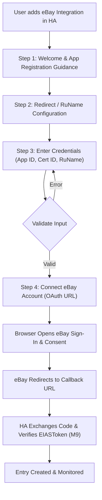

# Architecture Decision Record: Guided Bring-Your-Own (BYO) eBay OAuth Architecture & Onboarding Specification

> **Repository:** `andrewtryder/ha-ebay`
> **Status:** Architecture Decision Record & Feasibility Assessment (Milestone 10)
> **Version Baseline:** Home Assistant 2026.10.0+ (Python 3.14 locked)
> **Production Status:** Architecture & Specification Document. Zero production OAuth code replacement in this PR; zero managed credentials; BYO OAuth remains active.

---

## 1. Executive Summary & Product Objective

The product objective for `ha-ebay` authentication is clear:

> **Every `ha-ebay` user should continue to own and configure their own eBay developer application. We do NOT want one shared eBay application for all users. We want to make the existing Bring-Your-Own (BYO) OAuth setup dramatically easier.**

### The Decision: **GO — Guided Bring-Your-Own (BYO) eBay OAuth Setup**

The integration firmly adopts the **user-owned developer application model** as its permanent, long-term architectural baseline. We reject central token brokers, distributed shared secrets, and speculative external cloud dependencies as current project objectives.

Instead, Milestone 10 establishes a concrete specification for a **Home Assistant-First Guided Onboarding Wizard** that eliminates user confusion, explains the eBay developer portal steps, automatically provides copyable redirect and privacy URLs, validates keys, and manages modern OAuth 2.0 access and refresh tokens transparently.

```
┌──────────────────────────────────────────────────────────────────────────────────┐
│                             TARGET USER JOURNEY                                  │
├──────────────────────────────────────────────────────────────────────────────────┤
│ 1. User installs ha-ebay through HACS.                                           │
│ 2. Home Assistant walks the user through creating their eBay developer keyset.   │
│ 3. Integration presents exact, copyable Callback URLs and setup instructions.    │
│ 4. User inputs App ID (Client ID), Cert ID (Client Secret), and RuName.          │
│ 5. User clicks "Connect eBay Account".                                           │
│ 6. Standard eBay OAuth consent dialog appears in browser.                        │
│ 7. Home Assistant exchanges auth code and manages tokens/refreshes automatically.│
│ 8. Additional eBay accounts reuse the same keyset via M9 identity safeguards.    │
│    * USERS NEVER MANUALLY COPY, GENERATE, OR PASTE LEGACY AUTH'N'AUTH TOKENS *   │
└──────────────────────────────────────────────────────────────────────────────────┘
```

---

## 2. Separation of Independent Authentication Tasks

To simplify onboarding, the system clearly separates three independent tasks:

```
┌───────────────────────────┐      ┌───────────────────────────┐      ┌───────────────────────────┐
│          TASK 1           │      │          TASK 2           │      │          TASK 3           │
│   One-Time Developer App  │      │    One-Time eBay Account  │      │ Automatic Token Management│
│    Registration on eBay   │      │     Consent via OAuth     │      │     by Home Assistant     │
├───────────────────────────┤      ├───────────────────────────┤      ├───────────────────────────┤
│ • Performed on eBay portal│      │ • Performed in web browser│      │ • Performed locally in HA │
│ • User registers account  │      │ • Standard eBay login     │      │ • Code exchange for tokens│
│ • Creates App ID & Cert ID│      │ • Review read-only scopes │      │ • 2-hour access renewal   │
│ • Configures RuName URLs  │      │ • "Agree and Continue"    │      │ • 18-month refresh renewal│
│ MUST REMAIN IN PORTAL     │      │ SIMPLIFIED BY INTEGRATION │      │ FULLY AUTOMATED IN HA     │
└───────────────────────────┘      └───────────────────────────┘      └───────────────────────────┘
```

1. **Task 1: Developer Application Registration (eBay Developer Portal)**:
   - Must occur in eBay's portal (`developer.ebay.com/my/keys`) because eBay enforces developer registration, terms acceptance, and keyset generation on its own platform (`OFFICIAL_SPEC`).
   - `ha-ebay` cannot automate account creation inside eBay's portal. However, `ha-ebay` **can** dramatically simplify this by providing exact copy-paste URLs, field mappings, and portal guidance directly in the setup flow.
2. **Task 2: User Account Authorization Consent (Standard eBay OAuth Web Flow)**:
   - The user authorizes their regular eBay marketplace buyer/seller account to interact with their developer application.
   - Handled seamlessly via standard browser redirect or manual code paste troubleshooting fallback (`REPO_VERIFIED`).
3. **Task 3: Automated Token Lifecycle Management (Home Assistant Runtime)**:
   - Home Assistant automatically exchanges the authorization code for an OAuth access token (valid 2 hours) and refresh token (valid 18 months).
   - The integration automatically refreshes tokens in the background before expiration.
   - **Critical Principle**: Users are **never** asked to copy XML user tokens, Auth'n'Auth keys, or manual bearer strings.

---

## 3. Analysis of Rejected Architectural Alternatives

For architectural completeness, we document why alternative architectures were evaluated and rejected:

| Architecture Track | Evaluation | Decision | Justification |
|---|---|---|---|
| **Option A: Guided BYO Developer Credentials** | User registers own app; HA guides setup and manages OAuth. | **GO (Primary)** | Direct local control, isolated rate limits, zero maintainer hosting liability, zero secret distribution, 100% compliant with eBay API License Agreement. |
| **Option B: HA Core `application_credentials`** | Use Home Assistant's standard credentials repository. | **CONDITIONAL / HOLD** | Requires architectural adaptation: `ClientCredential` only stores `client_id` and `client_secret`, whereas eBay mandates `runame` as a third credential. In addition, environment selection (Production vs Sandbox) is not natively partitioned. Improving the custom config flow is more practical. |
| **Option C: Embedded Shared Keyset in Repo/Client** | Single developer keyset hardcoded or distributed in HACS. | **REJECTED (NO-GO)** | Directly breaches eBay API License Agreement Section 5. Public disclosure leads to immediate automated key revocation, credential abuse, and rapid exhaustion of shared API call limits across all users. |
| **Option D1: Maintainer-Hosted Central Token Broker** | Maintainer operates an external OAuth proxy server. | **REJECTED (NO-GO)** | Imposes 24/7 server infrastructure costs, secret custody risks, user data liability, GDPR/CCPA processor obligations, and potential service-wide outages if the broker fails or is blocked. Explicitly outside project objectives. |
| **Option D2: Nabu Casa Home Assistant Cloud Account Linking** | Commercial cloud account linking through Nabu Casa. | **NON-GOAL (Out of Scope)** | Nabu Casa cloud linking is strictly reserved for Core integrations with commercial partnerships. It cannot be enabled by a HACS custom integration and is not an active goal for this repository. |

---

## 4. Evaluation of Home Assistant `application_credentials`

We audited Home Assistant Core's [`application_credentials`](https://developers.home-assistant.io/docs/core/platform/application_credentials) platform to determine whether it would improve the BYO experience:

### 4.1 Structural Mismatches
1. **The RuName Requirement**:
   - Home Assistant's `ClientCredential` dataclass strictly defines:
     ```python
     @dataclass(frozen=True)
     class ClientCredential:
         client_id: str
         client_secret: str
     ```
   - eBay OAuth requires three distinct credentials: `client_id` (App ID), `client_secret` (Cert ID), and `runame` (eBay Redirect URL Name).
   - Under standard `application_credentials`, the `runame` would have to be stored outside the credential store (e.g., in `config_flow` user input or encoded artificially into the secret string), defeating the simplicity of the standard dialog.
2. **Environment Partitioning (Production vs. Sandbox)**:
   - Home Assistant `application_credentials` stores credentials per integration domain (`ebay`). It has no built-in schema for toggling between eBay Production and Sandbox keysets.
3. **Migration & M9 Compatibility**:
   - In Milestone 9, `ConfigEntry` stores credentials in `entry.data` keyed to the entry. Migrating to `application_credentials` risks separating the credentials from the entry, complicating atomic reauthorization and multi-account identity checks.

### 4.2 Assessment: Improve Custom Flow Instead
Because the existing custom `config_flow.py` already cleanly manages `client_id`, `client_secret`, `runame`, and `environment`, **enhancing the custom flow into a structured onboarding wizard is simpler, safer, and more user-friendly than adopting `application_credentials`**.

---

## 5. Technical Facts & Quota Analysis

We audited eBay's official documentation to correct previously overstated assumptions regarding rate limits, token expiry, and costs:

### 5.1 Quota Structure by API Family (`OFFICIAL_SPEC`)
Rate limits on the eBay Developer Program are **API-specific**, not a single universal bucket:
- **Trading XML API**: Default quota is **5,000 calls per day** per keyset.
- **REST APIs (Fulfillment, Finances, Analytics)**: Regulated by independent daily limits and rate limits per resource endpoint.
- **OAuth Identity Endpoint (`/identity/v1/oauth2/token`)**:
  - `grant_type=authorization_code`: **10,000 requests per day**.
  - `grant_type=refresh_token`: **50,000 requests per day**.
  - `grant_type=client_credentials`: **1,000 requests per day**.
- **Assessment**: Because routine token refreshes occur only once every 2 hours per account (12 calls/day), OAuth quota exhaustion is practically impossible in a BYO model. Furthermore, each user having their own keyset ensures they have their own dedicated 5,000 call/day Trading API quota, preventing "noisy neighbor" interference.

### 5.2 Token Lifecycles & Security Constraints (`OFFICIAL_SPEC`)
- **User Access Tokens**: Expire in **2 hours** (7,200 seconds).
- **User Refresh Tokens**: Valid for **18 months** (47,304,000 seconds). They are invalidated early if the user changes their eBay password, renames their account, or manually revokes application access in eBay account settings.
- **Non-Transferability**: OAuth authorization grants and refresh tokens are cryptographically tied to the issuing `client_id`. A token issued under Keyset A cannot be refreshed or used by Keyset B.
- **Absence of PKCE**: eBay does not support OAuth 2.0 PKCE for public clients on its token exchange endpoint; HTTP Basic Authentication with Client Secret is required.

---

## 6. Multi-Account Capabilities (Milestone 9 Alignment)

> [!IMPORTANT]
> **A single user-owned eBay developer application can authorize multiple distinct eBay marketplace accounts.**

Milestone 9 resolved the previous limitation where only one eBay account could be configured per developer application:
1. **Shared Keyset, Distinct Accounts**: A user with a personal buying account and a business selling account can authorize both accounts using the **same** App ID, Cert ID, and RuName (`REPO_VERIFIED`).
2. **Canonical Account Identity**: Identity is anchored to `User.EIASToken` via authenticated, read-only `GetUser` (`AccountIdentifierType.EIASTOKEN`). Each account receives an independent `ConfigEntry` keyed by `f"{environment}:{account_id}"`.
3. **Three-State Equivalence Safeguard**:
   - `AccountEquivalence.SAME`: Same account reauthorizing; updates tokens in-place and preserves legitimate username renames.
   - `AccountEquivalence.DIFFERENT`: Distinct accounts; creates separate, isolated `ConfigEntry` instances.
   - `AccountEquivalence.UNKNOWN`: Legacy fallback or missing EIASToken; fails closed with `account_ambiguous` to prevent duplicate entries.
4. **No Need for Multiple Developer Apps**: Users do **not** need to create multiple developer apps on eBay unless they are operating across different environments (Production vs Sandbox).

---

## 7. Next Implementation: Guided BYO OAuth Setup Specification

To execute the decision, the next feature PR will implement the following structured onboarding wizard within `custom_components/ebay/config_flow.py`:



### 7.1 Proposed Wizard Steps & UI Specifications

#### Step 1: `async_step_user` (Welcome & App Creation Guidance)
- **Purpose**: Explain why an eBay developer keyset is needed and provide direct links.
- **User-Facing Copy**:
  - Title: *"Set up eBay Integration"*
  - Text: *"To securely monitor your eBay account, you will connect your own free eBay developer keyset. This ensures your data stays private and your rate limits remain completely dedicated to your home."*
  - Key Guidance:
    - Link: `https://developer.ebay.com/my/keys` (Application Keys portal).
    - Note: *"You only need an **App ID** and **Cert ID**. A Dev ID is not required."*
    - Note: *"Choose **Production** for your real eBay account."*
- **Action**: Button: *"I have my keyset / Next"*.

#### Step 2: `async_step_redirect_guidance` (RuName & Callback Configuration)
- **Purpose**: Provide the exact URLs that the user must enter into eBay's developer portal.
- **User-Facing Copy**:
  - Title: *"Configure eBay Redirect (RuName)"*
  - Text: *"In the eBay Developer Portal, click 'Get a Token from eBay via Your Application' or 'View RuName' to configure your redirect URLs:"*
  - Copyable Fields (read-only text with copy buttons or clean formatting):
    - **Your auth accepted URL**: `https://my.home-assistant.io/redirect/oauth`
    - **Your auth declined URL**: `https://my.home-assistant.io/redirect/oauth`
    - **Privacy Policy URL**: `https://github.com/andrewtryder/ha-ebay/blob/main/PRIVACY.md`
  - Warning: *"Do not paste your Home Assistant internal IP or RuName into these URL fields. Enter the exact URL above."*
  - Notice: *"After saving, eBay will display your generated **RuName**. Copy it for the next step."*
- **Action**: Button: *"Next"*.

#### Step 3: `async_step_credentials` (Enter Keyset Credentials)
- **Purpose**: Collect the user's keyset credentials.
- **Fields**:
  1. `environment`: Dropdown (`Production` default, `Sandbox`).
  2. `client_id`: Text input (*"App ID (Client ID)"*). Strips leading/trailing whitespace.
  3. `client_secret`: Password input (*"Cert ID (Client Secret)"*). Strips leading/trailing whitespace.
  4. `runame`: Text input (*"RuName (eBay Redirect URL name)"*). Strips leading/trailing whitespace.
  5. `site_id`: Dropdown (Marketplace selection, default `eBay United States`).
  6. `manual_authorization`: Checkbox (*"Manual authorization (troubleshooting fallback)"*, default unchecked).
- **Validation**:
  - Check for empty fields (`required`).
  - Check that RuName matches expected format (not a URL, no spaces).
  - Check that App ID does not look like an RuName or URL.
  - Return friendly, actionable errors if malformed.

#### Step 4: `async_step_auth` / `async_step_manual` (Connect eBay Account)
- **Standard Path**: Uses Home Assistant's native OAuth helper to open `https://auth.ebay.com/oauth2/authorize?client_id=...&redirect_uri=RUNAME&...`.
- **Manual Fallback**: Displays the consent link and prompts the user to paste the callback URL or code.
- **Token Exchange & Identity Check**:
  - Exchanges code via `POST /identity/v1/oauth2/token`.
  - Executes read-only `GetUser` to obtain `EIASToken`.
  - Enforces M9 duplicate check across existing entries.
  - Creates or updates `ConfigEntry` atomically.

### 7.2 Configuration Flow Technical Changes
- Refactor `config_flow.py` to support the multi-step guidance cleanly.
- If reauthorizing an existing entry (`SOURCE_REAUTH`), skip steps 1 and 2 and jump directly to credential confirmation or OAuth authorization.
- Update `strings.json` and `translations/en.json` with the clear step titles, descriptions, and error strings.

### 7.3 Test Matrix for Implementation PR
1. Guided flow sequence test: step user -> step redirect -> step credentials -> step auth.
2. Keyset input validation: whitespace trimming, format checks (rejecting URLs entered in RuName field).
3. Reauth flow bypass: reauth enters credentials or directly re-triggers OAuth without showing introduction steps.
4. Multi-account onboarding: reusing the same credentials to add a second distinct account passes through M9 identity checks.
5. Manual fallback parity: manual flow completes same token normalization and M9 verification.

---

## 8. Summary of Documentation Alignments

1. [`docs/one-click-oauth-architecture.md`](one-click-oauth-architecture.md): Rewritten as the comprehensive Architecture Decision Record specifying the Guided BYO OAuth model.
2. [`docs/ebay-oauth-setup.md`](ebay-oauth-setup.md): Updated to correct multi-account documentation (confirming that M9 permits multiple accounts under one App ID) and providing copyable URLs.
3. [`docs/modernization-roadmap.md`](modernization-roadmap.md): Updated Milestone 10 deliverable status.
4. [`docs/existing-user-migration.md`](existing-user-migration.md): Clarified token non-transferability across developer apps.
5. [`docs/multiple-ebay-accounts.md`](multiple-ebay-accounts.md): Reaffirmed that account identity is independent of developer keysets.
